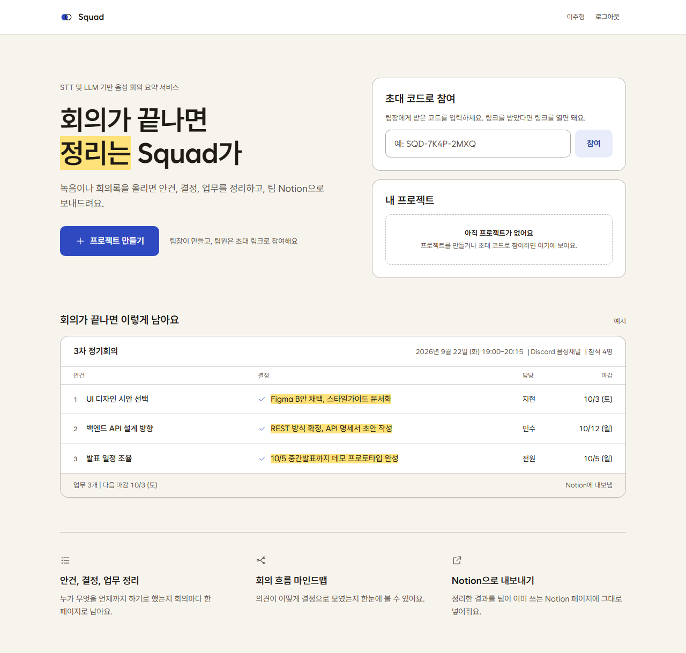
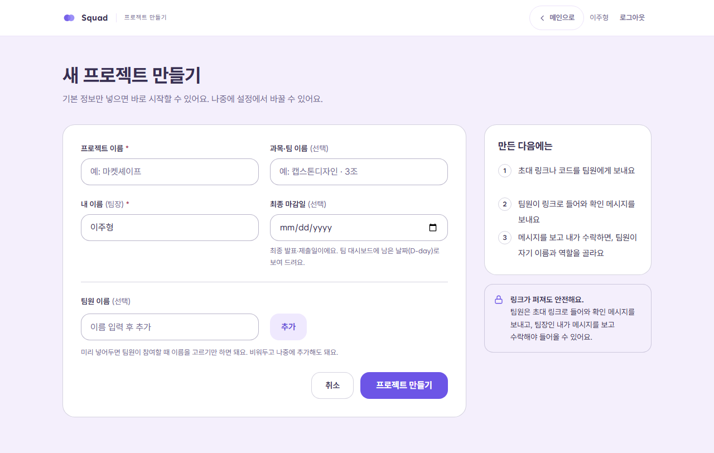
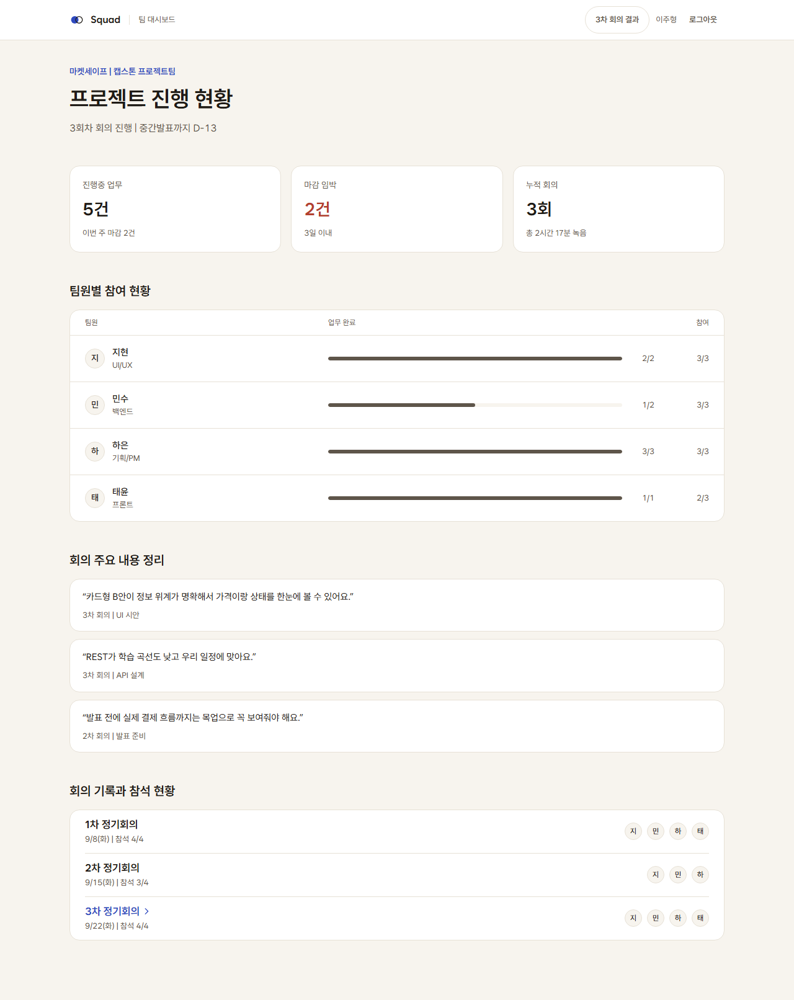
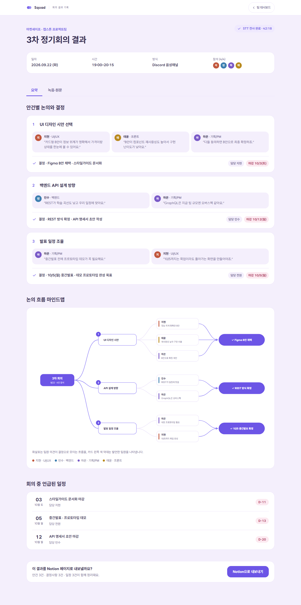

# Squad

팀명: Squad

작품명: Squad

팀원 학번/이름: 32203502/이주형

배포 주소: https://squad-dku.eastasia.cloudapp.azure.com

시연 영상 링크 : https://youtu.be/vx-j5368RIE

***

대학 조별과제 회의 녹음을 자동으로 정리하는 웹 서비스입니다.

회의 녹음을 올리면 STT와 화자 분리(diarization)를 거쳐 안건, 의견, 결정, 업무, 일정을 정리하고, 회의 흐름을 마인드맵으로 보여줍니다. 정리한 결과는 팀 대시보드에 쌓이고, 팀이 사용하는 Notion 페이지로 내보낼 수 있습니다.

## 주요 기능

구글 계정으로 로그인하고, 팀장이 프로젝트를 만든 뒤 초대 링크를 보냅니다. 팀원이 확인 메시지를 보내면 팀장이 수락하고, 프로젝트와 회의는 그 프로젝트의 팀원만 볼 수 있습니다.

회의 녹음을 올리면 faster-whisper(large-v3)로 받아쓴 문장이 실시간으로 화면에 나오고, pyannote로 화자를 분리한 뒤 "화자1 = 이주형"처럼 팀원과 연결합니다. 연결이 끝나면 Claude(Haiku)가 회의 1건에 한 번 호출되어 안건, 팀원별 의견, 결정, 업무, 일정을 정리합니다.

결과는 이렇게 확인하고 활용합니다.

- 회의 결과 페이지: 안건별 의견과 결정, 업무 체크리스트, 확대할 수 있는 마인드맵, 일정, 녹음과 원문 다시 듣기
- 팀 대시보드: 진행 중인 업무, 마감 임박, 팀원별 참여, 회의 주요 내용, 회의 기록과 참여 현황
- 내보내기: Notion 공개 연동으로 팀 페이지 안의 회의록 표에 한 줄씩 추가하거나 Markdown으로 복사
- 팀장 관리: 팀원 초대와 참여 요청 수락, 팀원 역할 수정과 삭제, 회의 기록 삭제, 프로젝트 삭제

## 화면 구성

### 메인

서비스 소개, 프로젝트 만들기, 초대 코드로 참여, 내 프로젝트 목록이 있습니다. 아래에는 회의가 끝나면 남는 결과를 표로 보여주며, 로그인하면 내 프로젝트의 최근 회의가 보입니다.



### 프로젝트 만들기

프로젝트 이름, 과목 또는 팀 이름, 팀장 이름, 미리 넣을 팀원 이름, 최종 마감일(달력)을 입력합니다. 만들면 초대 링크와 코드를 한 번 보여줍니다.



### 팀 대시보드

핵심 지표(진행 중인 업무, 마감 임박, 누적 회의), 팀원별 참여 현황, 회의 주요 내용 정리, 회의 기록과 참여 현황을 보여줍니다. 팀장에게는 팀 대시보드 관리, 팀원 초대, 참여 요청, Notion 연결이 함께 보입니다.



### 회의 결과

"요약" 탭에는 안건별 논의와 결정, 업무, 논의 흐름 마인드맵, 회의 중 언급된 일정이 있고, "회의 기록" 탭에서는 녹음을 다시 들으며 시간과 말한 사람이 붙은 원문을 따라 읽을 수 있습니다.



## 시스템 구성

```text
브라우저 ──▶ Nginx (HTTPS) ──▶ 웹 서버 (Next.js) ──▶ PostgreSQL
                                     ▲
                                     │ 워커 API (/api/worker/*, Bearer 토큰 인증)
                                     │
                  STT 워커 (GPU가 있는 PC, Python)
                  ├─ faster-whisper: STT
                  ├─ pyannote: 화자 분리
                  └─ Claude API: 회의 요약
```

웹 서버, DB, Nginx는 VM 한 대에 Docker Compose로 올립니다.

STT, 화자 분리, 요약처럼 무거운 작업은 GPU가 있는 PC의 STT 워커가 맡습니다. 워커는 DB에 직접 붙지 않고 워커 API로 작업을 가져가 결과를 올립니다. 요약도 워커가 Claude API를 직접 호출하고, 웹 서버는 프롬프트를 만들어 주고 결과를 검사해 저장합니다.

## 기술 스택

| 영역 | 사용 기술 |
| --- | --- |
| 웹 | Next.js 14 (App Router), React 18, TypeScript, Tailwind CSS |
| DB | PostgreSQL 17, Prisma |
| 로그인 | 구글 OAuth (arctic), 직접 만든 세션 (쿠키에는 무작위 값, DB에는 해시만 저장) |
| STT | faster-whisper `large-v3` |
| 화자 분리 | pyannote `speaker-diarization-community-1` |
| 요약 | Claude Haiku (JSON 스키마로 결과 형식 고정) |
| 내보내기 | Notion API (공개 연동, OAuth) |
| 배포 | Docker Compose, Nginx, Let's Encrypt |
| 테스트 | ESLint, Playwright (e2e) |

## 설치 요구 사항

웹만 실행할 때

- [Git](https://git-scm.com/)
- [Node.js](https://nodejs.org/) 20 이상
- [Docker Desktop](https://www.docker.com/products/docker-desktop/) (실행 상태여야 함, 로컬 PostgreSQL용)

STT 워커까지 실행할 때

- Python 3.13
- NVIDIA GPU (CUDA 12.8)
- [ffmpeg](https://ffmpeg.org/) (PATH에 등록)

필요한 키 (`apps/web/.env`, 항목은 [`.env.example`](./.env.example) 참고)

| 키 | 용도 |
| --- | --- |
| `AUTH_SECRET`, `ENCRYPTION_KEY`, `WORKER_TOKEN` | 서버 비밀값 (무작위 값을 직접 만들어 넣음) |
| `GOOGLE_CLIENT_ID`, `GOOGLE_CLIENT_SECRET` | 구글 로그인 |
| `ANTHROPIC_API_KEY` | 회의 요약 (워커가 사용) |
| `HF_TOKEN` | 화자 분리 모델 다운로드 (Hugging Face) |
| `NOTION_CLIENT_ID`, `NOTION_CLIENT_SECRET` | Notion 내보내기 (https 주소에서만 연결 가능) |

## 설치 및 실행

### 1. 프로젝트 다운로드

```bash
git clone https://github.com/20ljh/Squad.git
cd Squad
```

### 2. 웹 서버 실행

아래 명령은 로컬 서버 기준입니다.

```bash
cd apps/web
cp ../../.env.example .env   # 처음 한 번, 열어서 키를 채움
npm install
npm run db:up        # PostgreSQL 컨테이너 실행
npm run db:migrate   # 테이블 만들기
npm run db:seed      # 예시 데이터 넣기 (선택)
npm run dev          # http://localhost:3000
```

### 3. STT 워커 실행

아래 명령은 Windows 기준입니다.

```bash
# squad 폴더에서, 처음 한 번 설치
py -3.13 -m venv workers/stt/.venv
workers/stt/.venv/Scripts/python -m pip install --index-url https://download.pytorch.org/whl/cu128 --extra-index-url https://pypi.org/simple -c workers/stt/constraints.txt -r workers/stt/requirements.txt

# 실행
workers/stt/.venv/Scripts/python workers/stt/worker.py                       # 같은 PC의 웹 (localhost:3000)
workers/stt/.venv/Scripts/python workers/stt/worker.py --web https://웹주소    # 배포한 웹
```

처음 실행할 때는 STT 모델과 화자 분리 모델을 내려받느라 몇 분 걸릴 수 있습니다. 화자 분리 모델은 Hugging Face 모델 페이지에서 사용 조건에 먼저 동의해야 합니다.

## 배포 (VM + Docker Compose)

웹, DB, Nginx를 VM 한 대에 올립니다. 이미지는 로컬에서 빌드해 VM으로 보내고, VM에서는 빌드하지 않습니다.

```bash
# 처음 한 번: VM에 infra/env.prod.example 을 참고해 /opt/squad/.env 를 만듦
bash infra/deploy.sh                           # 이미지 빌드, VM으로 전송, 다시 띄움
ssh <VM> 'sh /opt/squad/init-letsencrypt.sh'   # 처음 한 번 HTTPS 인증서 발급
bash infra/deploy.sh --config                  # 설정 파일만 다시 올릴 때
```

구글 OAuth 클라이언트와 Notion 공개 연동의 리디렉션 주소는 각각 `{APP_URL}/api/auth/google/callback`, `{APP_URL}/api/notion/callback`입니다.

## 서버 종료 및 정리

```bash
# 웹 서버: 터미널에서 Ctrl+C
# 워커: 터미널에서 Ctrl+C

# 로컬 PostgreSQL 컨테이너 종료 (데이터는 남음)
docker compose stop db
```

## 테스트

```bash
cd apps/web
npm run typecheck
npm run lint
npm run build
npm run test:e2e   # DB가 켜져 있어야 함. 처음 한 번: npx playwright install chromium
```

## 프로젝트 구조

```text
squad/
├── apps/web/                 웹 서버 (Next.js)
│   ├── app/                  페이지와 API (app/api)
│   ├── components/           컴포넌트 (dashboard, meeting, ui 등)
│   ├── lib/                  DB 조회, 로그인, 요약 프롬프트, Notion 연동
│   ├── prisma/               DB 스키마, 마이그레이션, 예시 데이터
│   └── e2e/                  Playwright 테스트
├── workers/stt/              STT, 화자 분리, 요약 워커 (Python)
├── infra/                    배포 설정 (Docker Compose, Nginx, 배포 스크립트)
├── docs/
│   ├── background.md         기획 배경, 경쟁 서비스, 결정 기록
│   └── design/screens/       기준 스크린샷
├── docker-compose.yml        로컬 PostgreSQL
└── .env.example              환경 변수 목록
```

- `apps/web/lib/llm/summarize.ts`: 요약 프롬프트와 결과 저장 규칙 (호출은 워커가 함)
- `apps/web/lib/integrations/notion.ts`: Notion 회의록 표 만들기와 내보내기
- `workers/stt/worker.py`: 워커 API에서 작업을 가져가 STT, 화자 분리, 요약을 처리
- `infra/docker-compose.prod.yml`: 배포용 웹, DB, Nginx, 인증서 갱신 구성

단국대학교 소프트웨어학과 졸업작품 | 이주형
